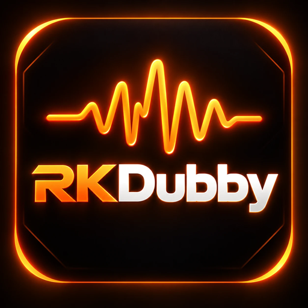
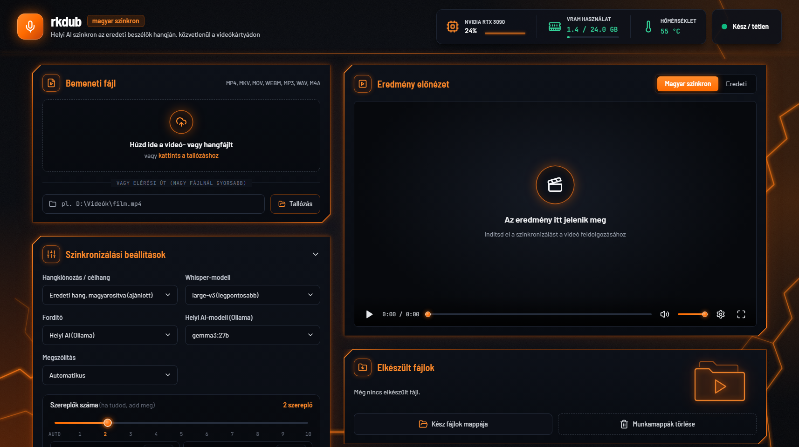

<p align="center"></p>

# rkdubby – helyi magyar szinkron

> **English summary:** rkdub dubs English (or other language) videos and audio files into Hungarian, locally on your NVIDIA GPU (or, more slowly, on the CPU), in the original speakers' voices — like ElevenLabs Dubbing, but offline. Pipeline: BS-Roformer speech/background separation → Whisper large-v3-turbo transcription with word timestamps (punctuation-hinted, with a second pass filling anything the hinted pass skipped) → two-stage speaker clustering (ECAPA voiceprints refined against per-speaker centroids, so a character keeps one voice) → translation by a local LLM (Ollama) or DeepL, with time budgets per line → OmniVoice zero-shot voice cloning in Hungarian, fitted to each line's time slot, every line checked by an ASR round-trip and a voiceprint check, and regenerated if it does not say what it should or drifts away from the character's voice → mix with the original background → MP4 with the Hungarian track, the original track and Hungarian subtitles. Local web UI with a line editor and a one-file Windows installer. Requirements: Windows 10/11 64-bit, NVIDIA GTX 10xx or newer with 8 GB VRAM (RTX with 12 GB+ recommended), 16 GB RAM; without a supported NVIDIA card (including GTX 9xx and older) it runs on the CPU, much more slowly.

Behúzol egy angol videót vagy hangfájlt, és a program magyarra szinkronizálja **az eredeti beszélők hangján**, a háttérzenét és a zajokat megtartva. Minden a saját gépeden fut: NVIDIA-videokártyán gyorsan, nélküle a processzoron, lassabban (lásd a [rendszerkövetelményeket](#rendszerkövetelmények)). Internet csak a telepítéshez kell.

<p align="center"></p>

**Letöltés:** a telepítő (`rkdub-telepito.exe`) a [Releases](https://github.com/rknoise/rkdub/releases/latest) oldalon van.

## Mit csinál?

1. **Beszéd és háttér szétválasztása** (BS-Roformer): a zene és a zajok megmaradnak, csak a beszéd cserélődik.
2. **Beszédfelismerés** (Whisper large-v3-turbo) szóidőkkel, írásjelekkel, mondatokra bontva. A Whisper néha hosszú szakaszokon írásjel nélkül ír; ilyenkor egy sorba több szereplő szövege kerülne. Ezért a program egy írásjeles „súgóval” futtatja, és ahol a súgós futás kihagy valamit, azt egy második futásból pótolja. Így minden sor egyetlen mondat, egyetlen beszélővel.
3. **Beszélők azonosítása**: ki melyik mondatot mondja, a hangszín alapján. A program először a hosszabb, megbízható mondatokból állítja össze a szereplők hangképét, aztán minden mondatot a hozzá leghasonlóbb szereplőhöz rendel. Így egy szereplő akkor is végig ugyanazon a hangon szól, ha hol nyugodtan beszél, hol kiabál. A hangminta a szereplő legjellemzőbb mondataiból készül. (Mérés egy 4 szereplős párbeszéden: a sorok 99%-a kapta a helyes hangot, a korábbi változattal 68%.)
4. **Fordítás** helyi AI-val (Ollama) vagy DeepL-lel, szinkronfordítói stílusban. A helyi AI tudja, mennyi ideje van egy mondatra, és ahhoz igazítja a fordítást. Utána még két kör jön: egy átnézés, és egy célzott javítás azokra a sorokra, amelyekben a program tükörfordítást talál („Ez egy…”, „-val való”, „számára”, „gaming”), vagy amelyek túl hosszúak.
   - **Kiejtés:** a feliratba a normál magyar szöveg kerül („FSR 4.1”, „Xbox”, „60 fps”). A hang viszont úgy mondja ki, ahogy egy magyar szinkronszínész: „ef-es-er négy pont egy”, „ikszboksz”, „hatvan ef-pé-es”. A számokat a ragokkal együtt a program írja ki („7000-es” → „hétezres”).
5. **Magyar hang az eredeti hangján** (OmniVoice hangklónozás). Alapból **magyarosított hangmintával**: minden beszélő hangján először egy magyar mintamondat készül, és a sorok ebből szólalnak meg. Így nincs angolos akcentus; a tesztben a felismerő 99%-ban magyarnak hallotta, az angol mintával 89%-ban.
6. **Időzítés**: a mondat a helyére kerül. Ha hosszabb, kicsit gyorsabban mondja. Ha nagyon nem fér el, a helyi AI rövidebb fordítást ad.
7. **Minőségellenőrzés**: minden kész magyar mondatot a gép visszahallgat. Ha elakadt, ismételt vagy kihagyott, újra elkészíti. Azt is megnézi, hogy a mondat a szereplő hangján szól-e. A hangmodell néha idegen hangon mond egy-egy rövid, felkiáltó mondatot, ilyenkor újrapróbálja.
8. **Keverés és mentés**: a videókép változatlan marad. Mellé kerül a magyar hangsáv és az eredeti hang második sávként, a magyar felirat pedig külön .srt fájlba (kérésre a videóba is). Hangfájlnál M4A vagy MP3 lesz az eredmény.

## Rendszerkövetelmények

| | Minimum | Ajánlott |
|---|---|---|
| Rendszer | Windows 10 vagy 11, 64 bites | Windows 11 |
| Videokártya | NVIDIA GeForce GTX 10xx vagy újabb, **8 GB** videómemóriával (pl. GTX 1070/1080, RTX 2060 Super, RTX 3060 Ti) | NVIDIA RTX **12 GB**-tól (pl. RTX 3060 12 GB, RTX 4070); a legjobb fordításhoz **24 GB** (RTX 3090/4090) |
| Processzor | 4 mag | 8 mag |
| Memória (RAM) | 16 GB | 32 GB |
| Szabad hely | kb. 23 GB | 40 GB, SSD-n |
| Internet | csak a telepítéshez (kb. 18 GB letöltés) | |
| Egy végig beszédes 15 perces videó | GTX 10xx-en még nincs mérve | kb. 25–30 perc (RTX 3090) |

- **A videómemória mérete** a fordítómodellt határozza meg: 24 GB-on gemma3:27b (a legtermészetesebb magyar), 12–16 GB-on 12b, ennél kevesebben 4b. A szinkron többi része 8 GB-ba belefér: mérve a legtöbbet a hangkészítés foglal a visszahallgatással együtt, kb. 6–8 GB-ot. 6 GB-os kártyán nincs kipróbálva.
- **GTX 10xx (Pascal):** az 1.3.1-től támogatott, a beszédfelismerés ott int8-cal fut. A GTX 9xx és a régebbi kártyákat (pl. **GTX 970**) a mostani PyTorch már nem támogatja, ezeken a telepítő processzoros módot választ.
- **NVIDIA-kártya nélkül** (AMD vagy Intel videokártyával, integrált videokártyával, vagy GTX 9xx-szel és régebbivel) a program [processzoros módban](#processzoros-mód-nvidia-kártya-nélkül) fut: minimum 4 magos processzor, 16 GB RAM és kb. 19 GB szabad hely kell hozzá, ajánlott a 8 mag és a 32 GB RAM. Ez jóval lassabb: egy végig beszédes 15 perces videó egy erős, 8 magos asztali processzoron kb. 3–4 óra, laptopon akár ennek a kétszerese. AMD Ryzen 7000-től gyorsabb, mert ott a hangmodell bfloat16-tal számol.

## Telepítés

### Egy lépésben: `rkdub-telepito.exe`

1. Futtasd az **`rkdub-telepito.exe`**-t (a `dist` mappában van, ez az egyetlen fájl kell hozzá).
2. Válaszd ki a helyet (alapból `C:\rkdub`; olyan útvonal kell, amiben **nincs ékezet**), és nyomd meg a **Telepítés** gombot.
3. A telepítő mindent letölt és beállít:
   - Python és saját környezet, PyTorch NVIDIA-gyorsítással (NVIDIA-kártya nélkül a processzoros változata, lásd [Processzoros mód](#processzoros-mód-nvidia-kártya-nélkül)), a program csomagjai;
   - **fordító AI:** Ollama (ha még nincs a gépen) és a **gemma3** fordítómodell a videókártyádhoz illő méretben (24 GB-on 27b, 12–16 GB-on 12b, kisebbnél és NVIDIA-kártya nélkül 4b);
   - beszéd- és hangmodellek (Whisper, OmniVoice, BS-Roformer);
   - asztali ikon, Start menü, eltávolító (a Windows *Telepített alkalmazások* listájában is megjelenik).
4. A végén **rkdub indítása**.

A telepítő ablakában végig látszik, melyik rész töltődik éppen, milyen sebességgel, hol tart a teljes folyamat, és mennyi van még hátra.

Rendszergazdai jog nem kell, minden a saját felhasználódhoz kerül. Internet kell hozzá, a letöltés mérete a videókártyádhoz illő fordítómodelltől függ:

| Videómemória | Fordítómodell | Teljes letöltés | Helyigény a lemezen |
|---|---|---|---|
| 20 GB-tól | gemma3:27b | kb. 32 GB | kb. 36 GB |
| 11–20 GB | gemma3:12b | kb. 23 GB | kb. 28 GB |
| 11 GB alatt | gemma3:4b | kb. 18 GB | kb. 23 GB |
| nincs NVIDIA-kártya (processzoros mód) | gemma3:4b | kb. 15 GB | kb. 19 GB |

Ha az Ollama már fent van a gépen, 1,7 GB-tal kevesebb; ha DeepL fordít helyi AI helyett (`/noollama`), az Ollama és a fordítómodell is kimarad.

Ha a letöltés megszakad, futtasd újra a telepítőt ugyanabba a mappába. A kész részeket nem tölti le újra, a PyTorch, az Ollama, a fordítómodell és a BS-Roformer ott folytatódik, ahol abbamaradt, a többi modellnél csak a félbemaradt fájl indul elölről.

**Frissítés:** futtasd az új telepítőt. Magától a meglévő telepítés mappáját ajánlja fel (a gomb ilyenkor *Frissítés*), és csak a program fájljait cseréli: a PyTorch, a csomagok, a modellek és az Ollama megmaradnak, nem töltődnek le újra.

A telepítő nincs digitálisan aláírva, ezért a Windows először figyelmeztethet („A Windows megvédte a számítógépet”): **További információ → Futtatás mindenképp**.

Felügyelet nélkül: `rkdub-telepito.exe /auto [/dir=D:\rkdub] [/noollama] [/nomodels] [/noshortcut]`. A `/cpu` kapcsolóval NVIDIA-kártyás gépen is processzoros módban telepít (kipróbáláshoz).

### Kézzel

A projektmappában az **`install.bat`** ugyanezt csinálja grafikus ablak nélkül. Az új telepítő a `tools\build_installer.ps1`-gyel készíthető el (a `dist` mappába).

### Eltávolítás

Windows Beállítások → Alkalmazások → **rkdub** → Eltávolítás (vagy az `eltavolitas.bat`). Rákérdez, hogy a kész videókat elmentse-e, és hogy a letöltött modelleket is törölje-e. Az Ollama megmarad, mert más program is használhatja; külön távolítható el.

### Fordító

Ajánlott a **gemma3:27b** (a teszteken ez fordított a legtermészetesebben magyarra), kisebb kártyán a gemma3:12b; ezt a telepítő magától választja. Helyi AI helyett DeepL-kulcs is jó; az rksubbyhez elmentett kulcsot a program magától megtalálja. A `gemma4` modellek az Ollama 0.40.2-ben hibás magyar szavakat írtak, ezért a program csak végső esetben választja őket.

## Használat

1. **Bemeneti fájl:** húzd be a videót (mp4, mkv, mov, webm…) vagy a hangfájlt (wav, mp3, m4a…), vagy keresd ki a **Tallózás** gombbal. Nagy fájlnál gyorsabb a Tallózás vagy az elérési út, mert akkor nem kell feltölteni.
2. **▶ Szinkronizálás indítása.** A folyamatjelző, a napló és a fejléc mutatja, hol tart. A fejlécben a videókártya terhelése, a videómemória és a hőmérséklet is látszik (processzoros módban a processzor terhelése és a memória).
3. **Eredmény előnézet:** a kész videó jobb oldalt lejátszható, a **Magyar szinkron / Eredeti** gombbal lejátszás közben is átváltható a hang (a fogaskerékkel a lejátszási sebesség is állítható). Az **Elkészült fájlok** a `kesz` mappába kerülnek:
   - `név_magyar.mp4`: a szinkronizált videó (1. hangsáv magyar, 2. az eredeti; kérésre beágyazott magyar felirattal),
   - `név_magyar_hangsav.m4a`: csak a magyar hangsáv,
   - `név_magyar.srt` / `név_eredeti.srt`: feliratok.
4. **Szöveg ellenőrzése és finomhangolása:** a hangszóró gombbal soronként meghallgathatod az eredetit vagy az új magyart (a „Meghallgatási sáv” gombokkal választhatsz). A **Magyar** és a **Kiejtés** oszlop átírható, és a **B1/B2…** választóval azt is, melyik szereplő mondja a sort (ha a program rosszul osztotta be). A **Hang készítése** gomb után csak a módosított sorok készülnek el újra. A ⚠ jel azt jelenti, hogy a visszahallgatás eltérést talált, vagy hogy a sor hangja újrapróbálás után is eltér a szereplőétől. Ezt érdemes meghallgatni.

A régi (Gradio-s) felület is elérhető még: `start.bat --classic`.

### Csak felirat (SRT)

A **Csak felirat (SRT)** gomb szinkron nélkül, az eredeti nyelven készít időzített feliratot a videóból vagy a hangfájlból (MP3, WAV...), például dalszöveghez. A program előbb leválasztja az éneket vagy a beszédet a zenéről, ezért zenés anyagnál is pontosabb. Az eredmény a `kesz\<név>.srt` fájl; a hosszabb sorok két sorba kerülnek, soronként legfeljebb 42 karakterrel. Pontosabb felismeréshez a beállításoknál válaszd a **large-v3** Whisper-modellt. Ha a beállításoknál bekapcsolod a *Csak felirat (SRT) gombnál magyar fordítás is* kapcsolót, mellé a magyar fordítás is elkészül ugyanazzal az időzítéssel (`kesz\<név>.hu.srt`; a lejátszók ezt a nevet magyar feliratként ismerik fel). Ehhez fordító kell: helyi AI (Ollama) vagy DeepL-kulcs.

Ha csak feliratot készítenél, a fordító AI nem kell: a telepítőben kapcsold ki az *Ollama* jelölőnégyzetet (`/noollama`), így kb. 13 GB a letöltés.

### Fordítás javíttatása (export / import)

1. Kapcsold be a **Megállás a fordítás után** beállítást: a program a fordítás után megáll, még nem készít hangot.
2. **⬇ Exportálás javításra**: a teljes szöveg (angol eredeti, magyar, időkeret, kiejtés) a `kesz\<név>_forditas.txt` fájlba és egy másolható dobozba kerül, az elején egy rövid angol utasítással egy AI-nak.
3. Add oda a szöveget pl. a Claude-nak: *„Javítsd ki a magyar szinkronszöveget a fájl elején lévő utasítások szerint, és add vissza a teljes fájlt.”*
4. A javítottat illeszd be a dobozba (vagy töltsd fel a fájlt), és nyomd meg: **⬆ Javított importálása**. Ha magát a `kesz` mappában lévő fájlt javíttatod (pl. a Claude Code-dal), az importálás onnan olvas.
5. **🔁 Hang készítése**: csak a megváltozott sorok készülnek el (újra).

### Beállítások

| | |
|---|---|
| Forrásnyelv | milyen nyelven beszélnek a felvételen; alapból **automatikus felismerés** |
| Célnyelv | erre a nyelvre fordít és szinkronizál: alapból **magyar**, de lehet angol, német, francia, spanyol, olasz, portugál, lengyel, holland, cseh, szlovák, román, svéd, török, orosz vagy ukrán is (pl. magyar videó angolra) |
| Fordító | Helyi AI (Ollama) vagy DeepL |
| Whisper-modell | large-v3-turbo (gyors) vagy large-v3 (pontosabb felismerés) |
| Megszólítás | automatikus / tegező / magázó |
| Beszédtempó | 0,85–1,15×; 1,00 = a beszélő természetes tempója |
| Szereplők száma | csúszka 0–10-ig: **auto** = a program dönti el; ha tudod, állítsd be (pontosabb). Ha több szereplőt adsz meg, mint ahányan valójában vannak, a nyilvánvalóan azonos embert a program akkor is egy hangnak veszi, így senki hangja nem esik szét. Alatta a **Nő / Férfi** mezőkbe beírhatod, hányan vannak (pl. 2 nő, 3 férfi): ilyenkor a program előbb nőkre és férfiakra bontja a szereplőket (a szereplő átlagos hangmagassága szerint, így egy kiabáló férfi mondata sem kerül a nőkhöz), így két különböző nemű szereplő hangja nem keveredik. A számozás is ehhez igazodik (B1–B2 nők, B3–B5 férfiak). Amit nem adsz meg, annak a nemét a program dönti el. |
| Hangklónozás / célhang | **célnyelvi kiejtéssel** (ajánlott): akcentus nélkül; **soronként**: az eredeti angol mondat a minta, jobban követi a hangsúlyt, de angolosabb; **beszélőnként**: angol minta, egységes hang |
| Megjegyzés a fordítónak | pl. a videó témája, nevek, kifejezések; a ✨ gombbal gyakori megjegyzések szúrhatók be (stílus, nevek, szakszavak) |
| Háttérzene és zajok | megmaradjanak-e |
| Nevetés, kiáltás, sóhaj | az eredeti hang nem beszédes részei megmaradjanak-e |
| Megállás a fordítás után | a hang csak akkor készül el, ha átnézted (vagy exportáltad, javíttattad, importáltad) a szöveget |
| Eredeti hang 2. hangsávként | a videóban átváltható az eredeti hangra |
| Magyar felirat beágyazása | alapból ki van kapcsolva, mert az MP4-et a lejátszók bekapcsolt felirattal nyitják meg; a külön `.srt` mindig elkészül |

Megszakítás után, vagy ha ugyanazt a fájlt újra elindítod, onnan folytatja, ahol abbahagyta (a `munkak` mappában vannak a köztes fájlok, nyugodtan törölhetők).

## Teljesítmény (RTX 3090)

Mért adatok (40 mp-es, kétszereplős próbavideó, gemma3:27b):

| Lépés | Idő |
|---|---|
| Beszéd és háttér szétválasztása | ~15 mp |
| Beszédfelismerés | ~4 mp |
| Beszélők azonosítása | ~11 mp |
| Fordítás + átnézés | ~30 mp |
| Magyar hang (13 sor, ellenőrzéssel) | ~60–75 mp (kb. 5 mp/sor) |
| Keverés, mentés | ~3 mp |
| **Összesen** | **~2 perc** |

- Hosszabb videónál a magyar hang készül a legtovább, kb. 4–6 mp mondatonként, az ellenőrzéssel együtt. Egy 10 perces videó kb. 15–20 perc.
- Videómemória: lépésenként töltődnek be a modellek, a fordítás után az Ollama-modell kiürül a kártyáról. Minden szinkron külön folyamatban fut, a végén minden memória felszabadul.
- Telepítés után internet nélkül is működik (a modellek helyben vannak; ha a `.models\letoltve.txt` fájlt törlöd, újra ellenőrzi őket).

## Processzoros mód (NVIDIA-kártya nélkül)

A GTX 10xx kártyákon (Pascal) a videokártyás mód megy, de ez a generáció nem tud float16-ot, ezért ott a beszédfelismerés int8-cal fut. A régebbi kártyákat (GTX 9xx és korábbi) a PyTorch már nem támogatja, ezeken a telepítő processzoros módot választ.

Ha a gépben nincs NVIDIA-videokártya, a telepítő ezt magától felismeri, és processzoros módban telepít: a PyTorch processzoros változatát (0,6 GB a 3,5 GB helyett) és a kis gemma3:4b fordítómodellt. A program ugyanaz, a fejlécben „Processzoros mód” látszik, és könnyített beállításokkal fut:

- a hangmodell 16 lépéssel dolgozik 32 helyett, és ahol a processzor natívan tudja (AMD Ryzen 7000-től, Zen 4), bfloat16 számítással. A teszten ugyanolyan érthető és ugyanannyira hasonló hangot adott, 3,4-szer gyorsabban;
- a kész sorokat nem hallgatja vissza a Whisperrel (processzoron ez soronként kb. 7 mp lenne). A sorokat a felületen meghallgathatod, és egyenként újragenerálhatod;
- a beszéd és a háttér szétválasztása kisebb átfedéssel fut: 1,8-szer gyorsabb, a beszédsáv gyakorlatilag ugyanaz;
- fordításra a gemma3:4b-t választja: a 27b processzoron órákig fordítana, és 16 GB memóriába el sem fér. A 4b magyarja viszont érezhetően gyengébb, ezért processzoron jobb a **DeepL** (ingyenes kulccsal is, és egy perc alatt kész), vagy a fordítás javíttatása (export / import).

Mért adatok (Ryzen 7 7800X3D, csak processzor, ugyanaz a 40 mp-es próbavideó):

| Lépés | Idő |
|---|---|
| Beszéd és háttér szétválasztása | ~150 mp |
| Beszédfelismerés | ~20 mp |
| Beszélők azonosítása | ~10 mp |
| Fordítás + átnézés (gemma3:4b, processzoron) | ~80 mp |
| Magyar hang (13 sor) | ~325 mp (kb. 17 mp/sor) |
| **Összesen** | **~10 perc** |

Egy végig beszédes 15 perces videó ezen a gépen kb. 3–4 óra, egy laptopon akár ennek a kétszerese: érdemes éjszakára elindítani. Intel processzorokon (és a Zen 4 előtti AMD-ken) nincs bfloat16, ott a hang készítése kb. 1,7-szer lassabb. Memóriából 16 GB elég.

**Integrált videokártya (iGPU):** a hangmodell és a hangleválasztó Windowson nem tudja használni, ezek a processzoron futnak. A fordító AI (Ollama) a Vulkan-motorjával elvileg igen, de alapból kihagyja az integrált kártyát; az `OLLAMA_IGPU_ENABLE=1` környezeti változóval és az Ollama újraindításával bekapcsolható (nincs kipróbálva).

NVIDIA-kártyás gépen is kipróbálható: `start.bat --cpu` (a telepítőnél `/cpu`).

## Korlátok

- **Más célnyelvek:** a program a magyarra van a leginkább hangolva. Magyar célnyelvnél egy külön kör kijavítja a tükörfordításokat, és a számokat, rövidítéseket, neveket magyar kiejtés szerint írja ki. Más célnyelvnél ez a két lépés kimarad, a hangmodell maga olvassa fel a számokat.

- **Akcentus:** a magyarosított hangmintával alig hallható. A soronkénti módban (angol minta) a magyar beszéd néha angolos.
- **Szájmozgás:** nincs szájszinkron, a mondatok időzítése igazodik az eredetihez (mint az ElevenLabsnél).
- **Egymásba beszélés:** ha egyszerre többen beszélnek, a beszélők szétválasztása pontatlanabb.
- **Sok hasonló hangú szereplő:** ha több szereplő van, mint amennyit megadsz (pl. egy jelenetben 9 ember, a csúszkán 4), a hasonló hangú mellékszereplők egy főszereplő hangját kapják. Ha két hasonló hangú fiatal nő is van, a hangszín alapján a program néha egynek veszi őket. Ilyenkor a sorok a **B1/B2…** választóval átírhatók.
- **Korábbi munkák:** egy régebbi munkamappa (a `munkak` mappában) csak akkor készül el újra az új beszéd- és beszélőfelismeréssel, ha nincs benne kézi javítás. A kézzel javított munkát a program nem bontja meg.
- **Hangminta jogai:** csak olyan videót szinkronizálj, amelynek a hangjához jogod van. Saját, nem kereskedelmi célra használd; az OmniVoice-modell licence CC-BY-NC.

## Parancssor

```
.venv\Scripts\python.exe rkdub.py --cli video.mp4 [--speakers 2] [--deepl] [--model gemma3:27b] [--ref speaker] [--source fr] [--target hu] [--cpu]
```

## Próba

A `minta` mappában van egy 40 mp-es, kétszereplős angol próbavideó (`probavideo_angol.mp4`) és a program által készített magyar változata (`probavideo_magyar.mp4`).
