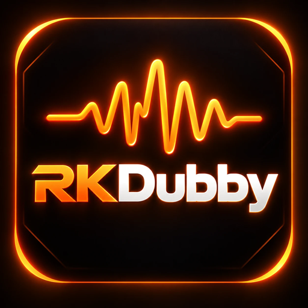
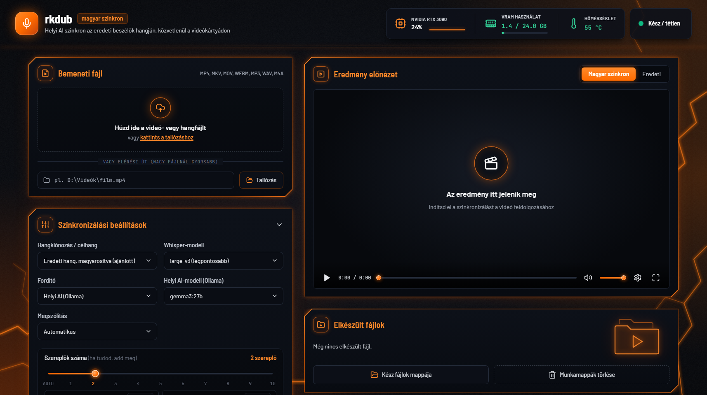

<p align="center"></p>

# rkdub – helyi magyar szinkron

> **English summary:** rkdub dubs English (or other language) videos and audio files into Hungarian, locally on your NVIDIA GPU, in the original speakers' voices — like ElevenLabs Dubbing, but offline. Pipeline: BS-Roformer speech/background separation → Whisper large-v3-turbo transcription with word timestamps → speaker clustering (ECAPA voiceprint + pitch) → translation by a local LLM (Ollama) or DeepL, with time budgets per line → OmniVoice zero-shot voice cloning in Hungarian, fitted to each line's time slot, every line checked by an ASR round-trip and regenerated if it doesn't say what it should → mix with the original background → MP4 with the Hungarian track, the original track and Hungarian subtitles. Local web UI with a line editor and a one-file Windows installer.

Behúzol egy angol videót vagy hangfájlt, és a program magyarra szinkronizálja **az eredeti beszélők hangján**, a háttérzenét és a zajokat megtartva. Minden a saját gépeden fut, a videókártyádon (RTX 3090-en tesztelve). Internet csak a telepítéshez kell.

<p align="center"></p>

**Letöltés:** a telepítő (`rkdub-telepito.exe`) a [Releases](https://github.com/rknoise/rkdub/releases/latest) oldalon van.

## Mit csinál?

1. **Beszéd és háttér szétválasztása** (BS-Roformer): a zene és a zajok megmaradnak, csak a beszéd cserélődik.
2. **Beszédfelismerés** (Whisper large-v3-turbo) szóidőkkel, mondatokra bontva.
3. **Beszélők azonosítása**: ki melyik mondatot mondja (több szereplőnél mindenki a saját hangján szólal meg).
4. **Fordítás** helyi AI-val (Ollama) vagy DeepL-lel, szinkronfordítói stílusban. A helyi AI tudja, mennyi ideje van egy mondatra, és ahhoz igazítja a fordítást. Utána még két kör jön: egy átnézés, és egy célzott javítás azokra a sorokra, amelyekben a program tükörfordítást talál („Ez egy…”, „-val való”, „számára”, „gaming”), vagy amelyek túl hosszúak.
   - **Kiejtés:** a feliratba a normál magyar szöveg kerül („FSR 4.1”, „Xbox”, „60 fps”). A hang viszont úgy mondja ki, ahogy egy magyar szinkronszínész: „ef-es-er négy pont egy”, „ikszboksz”, „hatvan ef-pé-es”. A számokat a ragokkal együtt a program írja ki („7000-es” → „hétezres”).
5. **Magyar hang az eredeti hangján** (OmniVoice hangklónozás). Alapból **magyarosított hangmintával**: minden beszélő hangján először egy magyar mintamondat készül, és a sorok ebből szólalnak meg. Így nincs angolos akcentus; a tesztben a felismerő 99%-ban magyarnak hallotta, az angol mintával 89%-ban.
6. **Időzítés**: a mondat a helyére kerül. Ha hosszabb, kicsit gyorsabban mondja. Ha nagyon nem fér el, a helyi AI rövidebb fordítást ad.
7. **Minőségellenőrzés**: minden kész magyar mondatot a gép visszahallgat. Ha elakadt, ismételt vagy kihagyott, újra elkészíti.
8. **Keverés és mentés**: a videókép változatlan marad. Mellé kerül a magyar hangsáv és az eredeti hang második sávként, a magyar felirat pedig külön .srt fájlba (kérésre a videóba is). Hangfájlnál M4A vagy MP3 lesz az eredmény.

## Telepítés

### Egy lépésben: `rkdub-telepito.exe`

1. Futtasd az **`rkdub-telepito.exe`**-t (a `dist` mappában van, ez az egyetlen fájl kell hozzá).
2. Válaszd ki a helyet (alapból `C:\rkdub`; olyan útvonal kell, amiben **nincs ékezet**), és nyomd meg a **Telepítés** gombot.
3. A telepítő mindent letölt és beállít:
   - Python és saját környezet, PyTorch NVIDIA-gyorsítással, a program csomagjai;
   - **fordító AI:** Ollama (ha még nincs a gépen) és a **gemma3** fordítómodell a videókártyádhoz illő méretben (24 GB-on 27b, 12–16 GB-on 12b, kisebbnél 4b);
   - beszéd- és hangmodellek (Whisper, OmniVoice, BS-Roformer);
   - asztali ikon, Start menü, eltávolító (a Windows *Telepített alkalmazások* listájában is megjelenik).
4. A végén **rkdub indítása**.

Rendszergazdai jog nem kell, minden a saját felhasználódhoz kerül. Internet kell hozzá: kb. 25–35 GB letöltés (a 27b fordítómodellel együtt), a géptől és a nettől függően 20–60 perc. Ha megszakad, futtasd újra: a már letöltött részeket nem kezdi elölről.

A telepítő nincs digitálisan aláírva, ezért a Windows először figyelmeztethet („A Windows megvédte a számítógépet”): **További információ → Futtatás mindenképp**.

Felügyelet nélkül: `rkdub-telepito.exe /auto [/dir=D:\rkdub] [/noollama] [/nomodels] [/noshortcut]`.

### Kézzel

A projektmappában az **`install.bat`** ugyanezt csinálja grafikus ablak nélkül. Az új telepítő a `tools\build_installer.ps1`-gyel készíthető el (a `dist` mappába).

### Eltávolítás

Windows Beállítások → Alkalmazások → **rkdub** → Eltávolítás (vagy az `eltavolitas.bat`). Rákérdez, hogy a kész videókat elmentse-e, és hogy a letöltött modelleket is törölje-e. Az Ollama megmarad, mert más program is használhatja; külön távolítható el.

### Fordító

Ajánlott a **gemma3:27b** (a teszteken ez fordított a legtermészetesebben magyarra), kisebb kártyán a gemma3:12b; ezt a telepítő magától választja. Helyi AI helyett DeepL-kulcs is jó; az rksubbyhez elmentett kulcsot a program magától megtalálja. A `gemma4` modellek az Ollama 0.40.2-ben hibás magyar szavakat írtak, ezért a program csak végső esetben választja őket.

## Használat

1. **Bemeneti fájl:** húzd be a videót (mp4, mkv, mov, webm…) vagy a hangfájlt (wav, mp3, m4a…), vagy keresd ki a **Tallózás** gombbal. Nagy fájlnál gyorsabb a Tallózás vagy az elérési út, mert akkor nem kell feltölteni.
2. **▶ Szinkronizálás indítása.** A folyamatjelző, a napló és a fejléc mutatja, hol tart. A fejlécben a videókártya terhelése, a videómemória és a hőmérséklet is látszik.
3. **Eredmény előnézet:** a kész videó jobb oldalt lejátszható, a **Magyar szinkron / Eredeti** gombbal lejátszás közben is átváltható a hang (a fogaskerékkel a lejátszási sebesség is állítható). Az **Elkészült fájlok** a `kesz` mappába kerülnek:
   - `név_magyar.mp4`: a szinkronizált videó (1. hangsáv magyar, 2. az eredeti; kérésre beágyazott magyar felirattal),
   - `név_magyar_hangsav.m4a`: csak a magyar hangsáv,
   - `név_magyar.srt` / `név_eredeti.srt`: feliratok.
4. **Szöveg ellenőrzése és finomhangolása:** a hangszóró gombbal soronként meghallgathatod az eredetit vagy az új magyart (a „Meghallgatási sáv” gombokkal választhatsz). A **Magyar** és a **Kiejtés** oszlop átírható, és a **B1/B2…** választóval azt is, melyik szereplő mondja a sort (ha a program rosszul osztotta be). A **Hang készítése** gomb után csak a módosított sorok készülnek el újra. A ⚠ jel azt jelenti, hogy a visszahallgatás eltérést talált, ezt érdemes meghallgatni.

A régi (Gradio-s) felület is elérhető még: `start.bat --classic`.

### Fordítás javíttatása (export / import)

1. Kapcsold be a **Megállás a fordítás után** beállítást: a program a fordítás után megáll, még nem készít hangot.
2. **⬇ Exportálás javításra**: a teljes szöveg (angol eredeti, magyar, időkeret, kiejtés) a `kesz\<név>_forditas.txt` fájlba és egy másolható dobozba kerül, az elején egy rövid angol utasítással egy AI-nak.
3. Add oda a szöveget pl. a Claude-nak: *„Javítsd ki a magyar szinkronszöveget a fájl elején lévő utasítások szerint, és add vissza a teljes fájlt.”*
4. A javítottat illeszd be a dobozba (vagy töltsd fel a fájlt), és nyomd meg: **⬆ Javított importálása**. Ha magát a `kesz` mappában lévő fájlt javíttatod (pl. a Claude Code-dal), az importálás onnan olvas.
5. **🔁 Hang készítése**: csak a megváltozott sorok készülnek el (újra).

### Beállítások

| | |
|---|---|
| Fordító | Helyi AI (Ollama) vagy DeepL |
| Whisper-modell | large-v3-turbo (gyors) vagy large-v3 (pontosabb felismerés) |
| Megszólítás | automatikus / tegező / magázó |
| Beszédtempó | 0,85–1,15×; 1,00 = a beszélő természetes tempója |
| Szereplők száma | csúszka 0–10-ig: **auto** = a program dönti el; ha tudod, állítsd be (pontosabb). Alatta a **Nő / Férfi** mezőkbe beírhatod, hányan vannak (pl. 2 nő, 3 férfi): ilyenkor a program hangmagasság szerint előbb nőkre és férfiakra bontja a sorokat, így két különböző nemű szereplő hangja nem keveredik. A számozás is ehhez igazodik (B1–B2 nők, B3–B5 férfiak). Amit nem adsz meg, annak a nemét a program dönti el. |
| Hangklónozás / célhang | **magyarosított** (ajánlott): akcentus nélkül; **soronként**: az eredeti angol mondat a minta, jobban követi a hangsúlyt, de angolosabb; **beszélőnként**: angol minta, egységes hang |
| Megjegyzés a fordítónak | pl. a videó témája, nevek, kifejezések; a ✨ gombbal gyakori megjegyzések szúrhatók be (stílus, nevek, szakszavak) |
| Háttérzene és zajok | megmaradjanak-e |
| Nevetés, kiáltás, sóhaj | az eredeti hang nem beszédes részei megmaradjanak-e |
| Megállás a fordítás után | a hang csak akkor készül el, ha átnézted (vagy exportáltad, javíttattad, importáltad) a szöveget |
| Eredeti hang 2. hangsávként | a videóban átváltható az eredeti hangra |
| Magyar felirat beágyazása | alapból ki van kapcsolva, mert az MP4-et a lejátszók bekapcsolt felirattal nyitják meg; a külön `.srt` mindig elkészül |

Megszakítás után, vagy ha ugyanazt a fájlt újra elindítod, onnan folytatja, ahol abbahagyta (a `munkak` mappában vannak a köztes fájlok, nyugodtan törölhetők).

## Teljesítmény (RTX 3090)

Mért adatok (40 mp-es, kétszereplős próbavideó, gemma3:27b):

| Lépés | Idő |
|---|---|
| Beszéd és háttér szétválasztása | ~15 mp |
| Beszédfelismerés | ~4 mp |
| Beszélők azonosítása | ~11 mp |
| Fordítás + átnézés | ~30 mp |
| Magyar hang (13 sor, ellenőrzéssel) | ~60–75 mp (kb. 5 mp/sor) |
| Keverés, mentés | ~3 mp |
| **Összesen** | **~2 perc** |

- Hosszabb videónál a magyar hang készül a legtovább, kb. 4–6 mp mondatonként, az ellenőrzéssel együtt. Egy 10 perces videó kb. 15–20 perc.
- Videómemória: lépésenként töltődnek be a modellek, a fordítás után az Ollama-modell kiürül a kártyáról. Minden szinkron külön folyamatban fut, a végén minden memória felszabadul.
- Telepítés után internet nélkül is működik (a modellek helyben vannak; ha a `.models\letoltve.txt` fájlt törlöd, újra ellenőrzi őket).

## Korlátok

- **Akcentus:** a magyarosított hangmintával alig hallható. A soronkénti módban (angol minta) a magyar beszéd néha angolos.
- **Szájmozgás:** nincs szájszinkron, a mondatok időzítése igazodik az eredetihez (mint az ElevenLabsnél).
- **Egymásba beszélés:** ha egyszerre többen beszélnek, a beszélők szétválasztása pontatlanabb.
- **Hangminta jogai:** csak olyan videót szinkronizálj, amelynek a hangjához jogod van. Saját, nem kereskedelmi célra használd; az OmniVoice-modell licence CC-BY-NC.

## Parancssor

```
.venv\Scripts\python.exe rkdub.py --cli video.mp4 [--speakers 2] [--deepl] [--model gemma3:27b] [--ref speaker]
```

## Próba

A `minta` mappában van egy 40 mp-es, kétszereplős angol próbavideó (`probavideo_angol.mp4`) és a program által készített magyar változata (`probavideo_magyar.mp4`).
